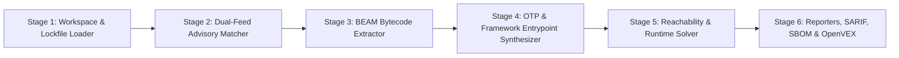

# System Architecture & Pipeline Internals

`vulncheck` is architected as a deterministic, six-stage static analysis pipeline operating over lockfiles, `.app` resource specifications, compiled `.beam` chunks, and cached vulnerability feeds.

---

## Stage 1: Workspace & Lockfile Loader (`VulnCheck.Workspace`)

1. **Project Auto-Detection:** Detects standard Mix projects (`mix.exs` + `mix.lock`), Mix Umbrella workspaces (`apps/*/mix.exs` sharing a root `mix.lock`), Erlang `rebar3` projects (`rebar.config` + `rebar.lock`), and Gleam projects (`gleam.toml` + `manifest.toml`).
2. **Environment Scoping (`:prod` vs Non-Production):**
   - Resolves the transitive production dependency closure starting from root application `.app` specifications (`applications` and `included_applications`) and Mix dependency options (`only: :dev`, `only: :test`, `runtime: false`).
   - Packages present in `mix.lock` solely for `:dev` or `:test` (such as `credo`, `ex_doc`, `dialyxir`, `meck`, `mox`) are tagged `scope: :non_prod` rather than discarded silently, allowing OpenVEX and verbose reports to prove why their advisories cannot trigger in production.
3. **Runtime Fingerprint:** Captures target Erlang/OTP release (`System.otp_release/0` or `--otp-version` override for cross-target CI checks) and Elixir version.

---

## Stage 2: Dual-Feed Advisory Aggregator (`VulnCheck.Feeds`)

Standard OSV Hex exports omit function-level symbols (`ecosystem_specific` is `null` in converted OSV Hex records), whereas upstream **EEF CNA CVE 5.1** records contain rich `programRoutines` arrays. `vulncheck` fuses three authoritative sources with zero API keys required:

1. **OSV.dev Hex Bulk Archive (`https://osv-vulnerabilities.storage.googleapis.com/Hex/all.zip`):**
   - Downloaded as a single compressed archive, size- and entry-limited before decompression, and revalidated with HTTP `ETag` / `If-None-Match` once the cache TTL expires.
   - Records of the same vulnerability of a package (the EEF `EEF-CVE-*` and GitHub `GHSA-*` records of one CVE share the CVE alias) are merged into one advisory: canonical id `EEF-CVE-*`, then `CVE-*`, then `GHSA-*`; united version ranges, symbols and references; the highest CVSS score.
   - Matched in memory against locked package versions in milliseconds.
2. **EEF CNA CVE 5.1 Enricher (`https://cna.erlef.org/cves/<CVE-ID>.json`, fallback `https://cveawg.mitre.org/api/cve/<CVE-ID>`):**
   - Fetched **only** for advisories whose package and version range match the target project's lockfile.
   - Extracts `containers.cna.affected[].programRoutines` (normalized from Erlang MFA strings like <code>'Elixir.Plug.Conn.Query':decode/4</code> or `hex_http_httpc:http_options/2` into `{module_atom_or_name, function_name, arity}`), `modules`, CVSS v3.1/v4.0 vectors, CWE identifiers, and OTP version constraints.
   - Cached on disk per CVE and refetched when the OSV record was modified after the cached copy was fetched.
3. **Hex.pm Package Retirement Metadata:**
   - Queries cached package retirement records to flag packages marked retired due to security or deprecation.

---

## Stage 3: Parallel `.beam` Bytecode Extractor (`VulnCheck.Beam`)

Analyzing raw `.ex` source files fails whenever control flow is generated by macros (`use Phoenix.Router`, `plug`, `Ecto.Query`, `Ash`, `Oban.Worker`). `vulncheck` operates directly on compiled `.beam` files inside `_build/<env>/lib/*/ebin/*.beam` (or `build/dev/erlang/*/ebin/*.beam` for Gleam):

1. **Chunk Inspection via `:beam_lib.chunks/2`:**
   - Reads `:abstract_code` (produced on demand from the Elixir `Dbgi` debug-info backend for Elixir modules), `:exports` and `:attributes`; modules without debug info fall back to their `:imports` table.
   - Never loads target `.beam` modules into the running scanner VM (`Code.ensure_loaded` is never called on target artifacts), preventing atom table pollution and side-effect execution.
2. **AST Call & Dispatch Extraction:**
   - Walks Erlang Abstract Format forms (`{:function, anno, name, arity, clauses}`) across concurrent `Task.async_stream` workers bounded by `System.schedulers_online/0`.
   - Extracts:
     - Direct local calls `{:call, anno, {:atom, _, fun}, args}`
     - Direct remote calls `{:call, anno, {:remote, _, {:atom, _, mod}, {:atom, _, fun}}, args}`
     - Function captures `{:fun, anno, {:function, mod, fun, arity}}` and MFA tuple literals `{mod, fun, arity}` passed to `Task`, `Supervisor`, `:telemetry.attach`, or `Oban`
     - Dynamic dispatch sites (`{:call, anno, {:remote, _, mod_expr, fun_expr}, args}` and `:erlang.apply/2,3`) with constant-propagated module/function atoms where resolvable, and `:dynamic_dispatch` markers where unresolved.
   - Preserves source file (`{:attribute, _, :file, {path, _}}`) and line numbers (`:erl_anno.line(anno)`) on every edge.
3. **Incremental Content-Addressed Cache:**
   - Each `.beam` file's extracted summary is keyed by `SHA-256(.beam bytes)` in a disk cache and decoded with `binary_to_term(bin, [:safe])`, so unchanged files are never analyzed twice. See [BENCHMARKS.md](BENCHMARKS.md) for measured scan times.

---

## Stage 4: BEAM-Aware Entrypoint & Callback Synthesizer (`VulnCheck.Entrypoints`)

Before running graph reachability, `vulncheck` constructs synthetic edges representing implicit BEAM runtime control flow:

1. **OTP Application Roots:** From each active production `.app` file's `{mod, {AppMod, _}}`, roots `AppMod.start/2` and traces child specifications (`Supervisor.init/2`, `child_spec/1`, `{ChildMod, opts}`).
2. **Network Daemon Roots:** Active HTTP/gRPC/socket server applications in the production release closure (`:bandit`, `:cowboy`, `:cowlib`, `:ranch`, `:thousand_island`, `:grpc`, `:plug_cowboy`) register their listener/protocol entrypoints automatically so transport-layer CVEs are never misclassified as unreachable.
3. **Behaviour & Pipeline Wiring:**
   - Links `Plug.Parsers` only to the parsers configured in reachable code (a `parsers: [:urlencoded]` inside `Plug.Debugger` does not widen an endpoint configured with `parsers: [:json]`).
   - Links `Plug` pipelines (`init/1` and `call/2` of every plug), `Phoenix.Endpoint`, `Phoenix.Router`, `Phoenix.LiveView` (`mount/3`, `handle_params/3`, `handle_event/3`, `handle_info/2`), `GenServer`, `GenStage`, `Broadway`, and `Oban.Worker` (`perform/1`).
   - Resolves consolidated Elixir protocols (`impl_for/1` dispatch targets across loaded structs).
4. **Configured Adapter Resolution:** Reads `config/config.exs`, `config/<env>.exs` and `config/runtime.exs` as quoted literals (never evaluated), the `configured_adapters` option and adapter literals in the project's compiled modules to tell active adapters of `Tesla`, `Swoosh`, `Ecto`, `Phoenix.PubSub`, `Finch` and `Req` apart from dormant transitive dependencies.

---

## Stage 5: Reachability & Runtime Constraint Solver (`VulnCheck.Solver`)

Given the directed call graph $G = (V, E)$, entrypoint root set $R \subset V$, and enriched advisories:

1. Checks dependency scope (`:non_prod` $\rightarrow$ `UNREACHABLE (:non_prod_dependency)`).
2. Checks runtime constraints (e.g., OTP major version unaffected $\rightarrow$ `UNREACHABLE (:otp_version_unaffected)`).
3. Runs breadth-first search (BFS) from $R$ to compute all statically reachable `MFA` vertices and parent pointers for shortest-path witness reconstruction.
4. Classifies each advisory into `REACHABLE`, `POTENTIALLY_REACHABLE`, or `UNREACHABLE` according to the soundness rules in [REACHABILITY_MODEL.md](REACHABILITY_MODEL.md).

---

## Stage 6: Policy Gate & Multi-Format Reporters (`VulnCheck.Report`)

Applies `.vulncheck.ignore` rules (checking expiry dates and `--forbid-new-suppressions`), optional `--baseline` / `--diff` filters, and renders the requested output formats (`terminal`, `json`, `markdown`, `sarif`, `github`, `gitlab`, `cyclonedx`, `openvex`) with deterministic ordering and exit codes.
